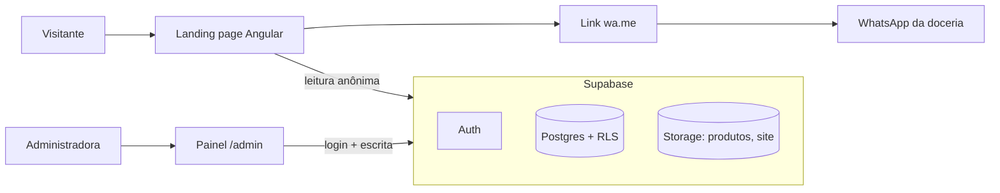
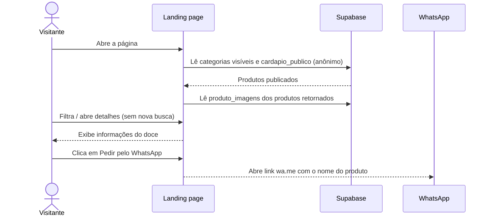
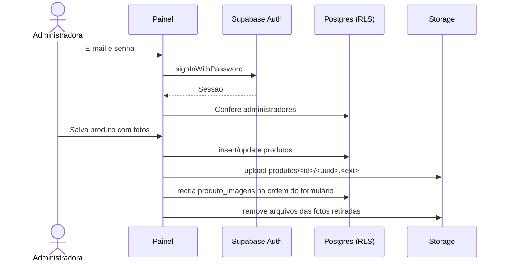

# ARCHITECTURE.md — Doceria da Mary

> **Status:** landing page pública e painel administrativo (login, cardápio, formulário de produto e categorias) integrados ao **Supabase** (banco Postgres com RLS, autenticação e armazenamento de imagens). O schema está versionado em `supabase/migrations/`; a ordem da integração está no [roadmap](docs/roadmap-integracao-supabase.md).

## 1. Visão geral

### Estado implementado

- Angular/CLI/Router 22.2.2, TypeScript 6.0.3 strict, componentes standalone OnPush e execução zoneless.
- Tailwind 4.3.3 via PostCSS, daisyUI 5.7.50 com tema claro `doceria-mary` e `@lucide/angular` 1.57.0 com ícones individuais.
- **Landing (`/`)**: rota lazy responsiva com apresentação, categorias, cardápio, sobre, encomendas, contato e rodapé. A casca é pré-renderizada e categorias e produtos são buscados no navegador por `CatalogRepository` (`features/catalog/catalog-repository.ts`), com skeleton, erro com "Tentar de novo" e cardápio vazio. `catalog.ts` guarda só contratos, filtro e formatação de preço; os dados de exemplo dos testes ficam em `catalog.fixture.ts`. `product-card` reutiliza a apresentação; `product-details` é um diálogo nativo com preço fixo/variável/"Sob consulta", observação de preço, galeria e "Bom saber".
- **Login (`/login`)**: formulário com validação e estados de envio. Entra pelo Supabase Auth (`core/auth/auth.ts`), confere `administradores` e guarda a sessão no navegador. `adminGuard` protege `/admin/**` e `guestGuard` leva quem já está logado ao painel; "Sair" encerra a sessão.
- **Painel (`/admin`)**: layout com menu lateral/gaveta. Cardápio (`/admin/cardapio`) com indicadores, busca, filtros, publicar/ocultar, exclusão e estados de carregamento, gravação e erro; formulário de produto (`/admin/cardapio/novo` e `/admin/cardapio/:id/editar`) com validação, até 5 fotos JPG/PNG/WEBP enviadas ao Storage e prévia; Categorias (`/admin/categorias`) com contagem do banco e mostrar/ocultar. O `MenuStore` (Signals) recarrega do banco a cada entrada nas telas por `AdminMenuRepository`. Configurações aparece no menu como indisponível.
- **Renderização**: `outputMode: "static"`; só a `/` é pré-renderizada, demais rotas usam `RenderMode.Client` (`index.csr.html`). O client do Supabase só é criado no navegador; nenhuma chamada ao banco roda no build. Entrada server Angular apenas para geração estática; nenhum servidor em produção.
- **Contato**: `core/config/public-config.ts` guarda WhatsApp e Instagram reais; `core/config/contact-links.ts` centraliza mensagens por contexto, validação do número e codificação dos links `wa.me`.
- **Supabase**: `@supabase/supabase-js` 2.118; URL do projeto e chave publishable em `src/environments/environment*.ts`; projeto ligado pela CLI (`supabase/config.toml`), migrations em `supabase/migrations/` e tipos gerados em `core/supabase/database.types.ts`. Os guards e o `supabase-js` são carregados sob demanda, fora do bundle inicial.
- Assets em `public/`: logo, fotos WebP e fontes Cormorant Garamond/DM Sans locais. Referências de design em `public/design/` excluídas do build.
- Vitest com cobertura V8 pelo builder Angular, Playwright no Chrome (com o Supabase simulado em `tests/browser/supabase-mock.ts`) e Prettier. Não há lint instalado.
- Especificações e tarefas em `specs/<funcionalidade>/` (fluxo do `AGENTS.md`).

A **Doceria da Mary** é uma aplicação web de apresentação de confeitaria artesanal. O visitante navega por uma landing page com catálogo digital e é direcionado ao WhatsApp para pedir. A administradora mantém o catálogo pelo painel.

**Objetivo principal:** navegação rápida, boa apresentação de produtos e conversão para conversa no WhatsApp, com o catálogo editável pela própria doceria.

**Não contempla:** carrinho, checkout, pagamento online, entrega/frete calculado ou contas de clientes.

## 2. Contexto do sistema



A landing lê de forma anônima e o painel escreve com a sessão da administradora.

O front fala **diretamente** com o Supabase pelo `supabase-js`, sem API própria. A segurança vem das políticas de Row Level Security (RLS) no banco, não do front.

## 3. Stack

| Camada             | Tecnologia                           | Papel                                            |
| ------------------ | ------------------------------------ | ------------------------------------------------ |
| Frontend           | Angular 22 + TypeScript strict       | UI, composição e lógica de apresentação          |
| Componentes        | Angular standalone, OnPush, zoneless | Organização e reutilização                       |
| Estilos            | Tailwind CSS v4 + daisyUI v5         | Layout, responsividade, tema semântico           |
| Ícones             | @lucide/angular                      | Ícones vetoriais                                 |
| Navegação          | Angular Router                       | Landing, login e painel                          |
| Estado local       | Angular Signals                      | Filtros, modais, formulários e listas            |
| Backend            | **Supabase**                         | Postgres, autenticação, armazenamento de imagens |
| Cliente do backend | `@supabase/supabase-js` 2.x          | Consultas, login e upload a partir do navegador  |
| Banco versionado   | Supabase CLI (`npx supabase`)        | Migrations em `supabase/migrations/`             |
| Atendimento        | Links públicos `wa.me`               | Abrir conversa no WhatsApp                       |
| Renderização       | SSG (`outputMode: "static"`)         | HTML estático; ver seção 5                       |
| Testes             | Vitest + Playwright                  | Unidade e ponta a ponta                          |

Versões exatas em `package.json` e no lockfile.

## 4. Organização de pastas

```text
src/
  app/
    core/
      config/               # configuração pública e links de contato (implementado)
      auth/                 # Auth (Supabase Auth + administradores) e guards
      supabase/             # client, tipos gerados, mapeamentos e mensagens de falha
    features/
      home/                 # landing page
      catalog/              # contratos, CatalogRepository, card e modal de produto
      auth/                 # tela de login
      admin/                # layout do painel, cardápio, formulário, categorias, MenuStore, AdminMenuRepository
    app.config.ts
    app.routes.ts
    app.routes.server.ts    # modo de renderização por rota
  environments/             # URL do Supabase e chave publishable
  styles.css                # Tailwind, plugin daisyUI e tema doceria-mary
supabase/
  config.toml               # projeto ligado pela CLI
  migrations/               # histórico do banco (fonte da verdade do schema)
```

### Regras de dependência

- `features/*` podem usar `shared/*` e `core/*`.
- `core/*` não contém detalhes de páginas.
- **Telas não chamam o `supabase-js` diretamente.** O acesso a dados fica em repositórios com interface própria na feature correspondente (`CatalogRepository`, `AdminMenuRepository`), classes abstratas cuja implementação padrão usa o Supabase. Isso mantém os componentes simples e permite trocar a implementação por uma falsa nos testes.
- O mapeamento entre colunas do banco (português, `snake_case`) e os contratos do front (`Product`, `Category`, `MenuItem`) acontece só nos repositórios.
- Não criar serviços genéricos sem uso concreto.

## 5. Rotas e renderização

| Rota                         | Propósito                  | Renderização                                           |
| ---------------------------- | -------------------------- | ------------------------------------------------------ |
| `/`                          | Landing e cardápio público | Prerender da casca; cardápio buscado no navegador (D1) |
| `/login`                     | Login da administradora    | Client; `guestGuard`                                   |
| `/admin` → `/admin/cardapio` | Lista do cardápio          | Client; `adminGuard`                                   |
| `/admin/cardapio/novo`       | Novo produto               | Client; `adminGuard` + `menuReady`                     |
| `/admin/cardapio/:id/editar` | Editar produto             | Client; `adminGuard` + `menuReady`; `:id` = `uuid`     |
| `/admin/categorias`          | Categorias                 | Client; `adminGuard`                                   |

Com dados no banco, ids de produto não existem no momento do build e a sessão só existe no navegador; por isso login e painel renderizam no cliente. A hospedagem precisa servir `index.csr.html` para `/login` e `/admin/**`.

**SEO:** com o cardápio buscado no navegador, o HTML pré-renderizado da `/` deixa de trazer os produtos. Pré-renderizar com os dados do banco fica para depois da escolha de hospedagem.

## 6. Componentes e funcionalidades

### Landing page (`home`)

Navbar com âncoras e CTA WhatsApp; hero; categorias; cardápio com filtros; sobre; chamada para encomendas; contato e redes; footer. O design aprovado define aparência e composição.

### Catálogo (`catalog`)

- Categorias e produtos visíveis, com filtro por categoria no cliente.
- Cards e modal de detalhes: descrição curta e longa, fotos, preço fixo / "A partir de" / "Sob consulta", observação de preço e "Bom saber".
- Encaminhamento ao WhatsApp com o nome do produto na mensagem.

### Login (`auth`)

Validação de e-mail e senha, estados de envio e erro. `signInWithPassword` do Supabase Auth, verificação de que o usuário está em `administradores` (senão a sessão é encerrada), sessão persistida no navegador e guards nas rotas. Mensagens: credenciais inválidas, sem conexão e indisponibilidade.

### Painel (`admin`)

- **Cardápio:** indicadores, busca, filtros, publicar/ocultar, excluir.
- **Formulário de produto:** nome, categoria, descrição, preço, "A partir de", até 5 fotos com principal, prévia.
- **Categorias:** contagem de produtos e mostrar/ocultar. Adicionar, editar e excluir estão indisponíveis.
- **Configurações:** indisponível (sem tela).

### Modelo do front

Contratos em `features/catalog/catalog.ts` (landing) e `features/admin/admin-menu-repository.ts` (`MenuItem`, `AdminCategory`, `ProductInput`; ids do painel são os `uuid` do banco):

```ts
export interface Category {
  readonly id: string; // = categorias.slug
  readonly name: string; // = categorias.nome (chip)
  readonly label: string; // = categorias.rotulo (cards e painel)
  readonly image: string;
}

export interface Product {
  readonly id: string; // = produtos.slug
  readonly name: string;
  readonly description: string;
  readonly details?: string; // = produtos.detalhes
  readonly priceNote?: string; // = produtos.observacao_preco
  readonly information?: readonly { icon: 'clock' | 'snowflake' | 'info'; text: string }[];
  readonly categoryId: string; // = categoria_slug
  readonly categoryLabel: string; // = categoria_rotulo
  readonly image: string; // URL pública da foto principal; vazia = sem foto
  readonly additionalImages?: readonly { src: string; alt: string }[];
  readonly price: { kind: 'fixed' | 'starting-at'; amountInCents: number } | null; // null = "Sob consulta"
}
```

Valores monetários ficam em centavos no front. O banco guarda `numeric(10,2)` e a conversão acontece no repositório (`amountInCents = round(preco * 100)`); `preco` nulo é "Sob consulta".

## 7. Fluxos principais

### Visitante escolhendo um produto



Falha em qualquer leitura mostra o estado de erro com "Tentar de novo".

### Administradora alterando o cardápio



### Geração do link do WhatsApp

- Número público com DDI, só dígitos, em `public-config.ts`.
- `https://wa.me/<numero>?text=<texto_codificado>` com `encodeURIComponent`, incluindo o nome do produto quando aplicável.
- A navegação externa não comprova conversa, pedido ou venda.

## 8. Dados e persistência

### Origem dos dados

- Landing e painel: Supabase, pelos repositórios. Falhas viram mensagens fixas (`loadError`, `saveError` em `core/supabase/supabase.ts`).
- Contatos: `public-config.ts` (Configurações do site ainda não usa o banco).

### Banco (Supabase)

Schema versionado em `supabase/migrations/` e aplicado com a CLI (`npx supabase db push --linked`). Alterações no banco são feitas **somente por migration**, nunca direto no painel do Supabase.

| Tabela / view                    | Conteúdo                                                                                                                                                                                                                                  |
| -------------------------------- | ----------------------------------------------------------------------------------------------------------------------------------------------------------------------------------------------------------------------------------------- |
| `categorias`                     | `nome` (chip, único), `slug`, `rotulo`, `imagem_url`, `visivel`, `ordem`                                                                                                                                                                  |
| `produtos`                       | `categoria_id` (FK, `on delete set null`), `nome` (≤ 80), `slug`, `descricao` (≤ 300), `detalhes`, `preco` (nulo = sob consulta, ≤ 99.999,99), `preco_a_partir`, `observacao_preco`, `informacoes` (jsonb validado), `publicado`, `ordem` |
| `produto_imagens`                | até 5 por produto; `storage_path` no bucket `produtos`; `posicao` 0 = principal                                                                                                                                                           |
| `configuracoes_site`             | linha única com identidade, contato, atendimento e textos da landing. **Ainda sem tela; não usada pelo front.**                                                                                                                           |
| `administradores`                | liga usuários do Supabase Auth ao papel de admin                                                                                                                                                                                          |
| `cardapio_publico` (view)        | produtos publicados com categoria visível (ou sem categoria), rótulo da categoria e foto principal                                                                                                                                        |
| `categorias_com_contagem` (view) | categorias com o total de produtos                                                                                                                                                                                                        |

Buckets do Storage: `produtos` (fotos dos doces) e `site` (logo e imagens da landing), públicos para leitura, JPG/PNG/WEBP até 5 MB.

| Migration                                       | Conteúdo                                                                                                |
| ----------------------------------------------- | ------------------------------------------------------------------------------------------------------- |
| `20261030041002_schema_inicial.sql`             | Tabelas, views, RLS, buckets e dados iniciais                                                           |
| `20261030042000_alinhar_catalogo_com_front.sql` | Colunas e limites que o front usa, `rotulo` da categoria, views recriadas e dados iguais a `catalog.ts` |

## 9. Design system

Tema daisyUI: `doceria-mary`.

| Token          | Valor     |
| -------------- | --------- |
| `primary`      | `#a65a6a` |
| `secondary`    | `#f0d2c8` |
| `accent`       | `#9bae8a` |
| `neutral`      | `#5a3a2e` |
| `base-100`     | `#fff8f3` |
| `base-200`     | `#f9ece6` |
| `base-300`     | `#f0d2c8` |
| `base-content` | `#2f2420` |
| `success`      | `#78956c` |
| `warning`      | `#c98a5a` |
| `error`        | `#b84f5f` |

Centralizar valores no tema, definir tokens `*-content` acessíveis e reutilizar classes semânticas. O dourado da logo é detalhe decorativo, não uma nova cor dominante.

## 10. Segurança, acessibilidade e desempenho

### Segurança

- O front usa só a **chave publishable** do Supabase, que é pública por natureza. A chave secret / `service_role` e a senha do banco **nunca** entram no repositório nem no front.
- A autorização é feita no banco por **RLS**:
  - visitante anônimo lê só categorias visíveis, produtos publicados e as fotos deles, e não grava nada;
  - só usuários cadastrados em `administradores` (função `is_admin()`) leem itens ocultos e gravam em tabelas e no Storage.
- O guard do Angular melhora a navegação, mas **não** é a proteção: ela está no RLS.
- Cadastro aberto de usuários deve ficar desativado no Supabase Auth.
- URLs e dados externos devem ser validados/escapados.
- Não processar pagamento nem armazenar pedidos.

### Acessibilidade

- Headings e landmarks semânticos; contraste, foco visível, teclado e labels associados.
- Modais com foco gerenciado, fechamento acessível e retorno de foco.
- Textos alternativos (`produto_imagens.alt`) e suporte a redução de movimento.
- Estados de carregamento e erro anunciados de forma acessível.

### Performance

- Imagens otimizadas; secundárias sob demanda.
- Uma consulta por tela sempre que possível (views prontas em vez de várias chamadas).
- Filtros e busca no cliente enquanto o volume for pequeno.
- Minimizar JavaScript inicial.

## 11. Qualidade e verificações

- Pelo menos um teste por critério de aceitação e 90% de cobertura por unidade (`AGENTS.md`).
- **Testes unitários não usam o Supabase real:** usam implementações falsas dos repositórios. O mapeamento banco ↔ modelo tem testes próprios com respostas de exemplo.
- **Playwright** intercepta as chamadas ao Supabase (`/rest/v1`, `/auth/v1`, `/storage/v1`) com fixtures, para não depender de rede nem de dados reais.
- Validar o RLS manualmente contra o projeto real a cada mudança de política: aba anônima não vê itens ocultos e não grava.
- Comandos de build e testes conforme os scripts de `package.json`.

## 12. Decisões arquiteturais

| ID      | Decisão                                                                             | Justificativa                                                                                       | Situação                                                      |
| ------- | ----------------------------------------------------------------------------------- | --------------------------------------------------------------------------------------------------- | ------------------------------------------------------------- |
| ADR-001 | Landing page no lugar de e-commerce                                                 | Reduz custo e complexidade; pedido concluído por conversa                                           | Definida                                                      |
| ADR-002 | Angular standalone e divisão por feature                                            | Organização incremental e APIs atuais                                                               | Implementada                                                  |
| ADR-003 | Tailwind v4 + daisyUI v5                                                            | Styling consistente com tema semântico                                                              | Implementada                                                  |
| ADR-004 | Catálogo local no MVP                                                               | Sem dependência inicial de backend                                                                  | **Substituída pela ADR-008**                                  |
| ADR-005 | WhatsApp via link `wa.me`                                                           | Integração simples sem serviço de mensagens                                                         | Definida                                                      |
| ADR-006 | SSG para página pública                                                             | Favorecer entrega de HTML e SEO                                                                     | Implementada para a `/`; login e painel renderizam no cliente |
| ADR-007 | Administração em fase futura                                                        | MVP enxuto                                                                                          | **Superada:** painel integrado ao Supabase                    |
| ADR-008 | **Supabase como backend** (Postgres + RLS, Auth, Storage), acessado direto do front | Dispensa API própria; autenticação e armazenamento prontos; plano gratuito suficiente para o volume | Implementada                                                  |
| ADR-009 | Schema versionado por migrations da Supabase CLI                                    | Histórico do banco junto com o código; ambientes reproduzíveis                                      | Implementada                                                  |
| ADR-010 | Acesso a dados por repositórios com interface própria                               | Telas e testes independentes do `supabase-js`                                                       | Implementada (`CatalogRepository`, `AdminMenuRepository`)     |

## 13. Pontos em aberto

- Validar manualmente contra o projeto real o login da Mary e as gravações do painel (publicar, excluir, criar com fotos).
- Tela de Configurações e uso de `configuracoes_site`. Quando entrar, ajustar a `check` de WhatsApp do banco (hoje 10–11 dígitos sem DDI; o front usa DDI `55`).
- Escolher a hospedagem e validar a publicação. A hospedagem precisa servir `index.csr.html` em `/login` e `/admin/**`.
- Fotos originais/adicionais dos produtos e confirmação de antecedência, conservação e alérgenos antes de cadastrá-los como reais.

## 14. Manutenção deste documento

Atualize este arquivo quando houver alterações em stack, roteamento, origem de dados, schema do banco, políticas de acesso, fronteiras das features, renderização, segurança ou decisões relevantes. Descreva apenas o que foi confirmado no repositório e identifique claramente o que ainda é alvo ou proposta.
