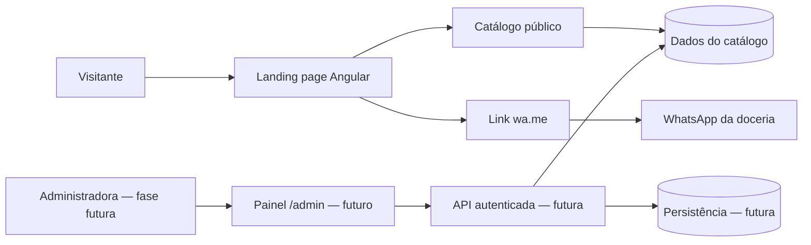
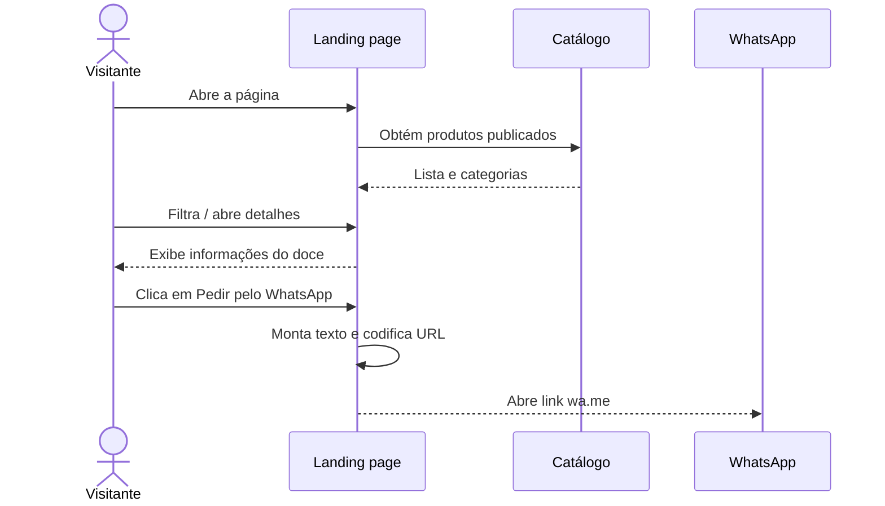

# ARCHITECTURE.md — Doceria da Mary

> **Status:** landing page pública implementada a partir das exportações desktop/mobile do Paper fornecidas pelo usuário. Catálogo demonstrativo, filtros locais e links WhatsApp/Instagram ativos. Administração e backend continuam futuros.

## 1. Visão geral

### Estado implementado no setup

- Angular/CLI/Router 22.2.2, TypeScript 6.0.3 strict, componentes standalone OnPush e execução zoneless.
- Tailwind 4.3.3 via PostCSS, daisyUI 5.7.50 com tema claro `doceria-mary` e `@lucide/angular` 1.57.0 com ícones individuais. O pacote atual do Lucide substitui o legado para compatibilidade com Angular 22.
- Rota `/` lazy com landing page responsiva: apresentação, categorias, cardápio, sobre, encomendas, contato e rodapé. Menu mobile e navegação por âncoras.
- `features/catalog/catalog.ts` contém contratos Product/Category, seis produtos demonstrativos, filtro puro e preços em centavos. `product-card` reutiliza a apresentação dos produtos; Home usa Signals e computed para filtro e menu. Não há modal representado nas referências fornecidas.
- `outputMode: "static"` e `RenderMode.Prerender` para `/`. Entrada server Angular apenas para geração estática; nenhum servidor Express ou SSR dinâmico em produção.
- Configuração tipada em `src/app/core/config/public-config.ts`, com WhatsApp/Instagram fornecidos pelo usuário; demais contatos e API continuam `null`. `core/config/contact-links.ts` centraliza mensagens por contexto, validação do número e codificação dos links wa.me. Os produtos incluem o nome na mensagem. Sem envio automático ou API de mensagens.
- Assets em `public/`: logo original, recortes das fotos das exportações em WebP e fontes Cormorant Garamond/DM Sans locais em WOFF2. PNGs @4x são referências e ficam fora do build. Favicon original ainda não fornecido.
- Vitest pelo builder Angular e Prettier; comandos e versões no README. Não há lint instalado.

As seções abaixo descrevem a arquitetura-alvo; detalhes ainda ausentes (modal, disponibilidade de produtos e administração) são futuros, sujeitos à autorização e aos designs do Paper. O estado vigente e validações estão em `docs/PROJECT_STATUS.md`; a origem das referências está em `docs/decisions/ADR-0001-referencias-exportadas.md`.

A **Doceria da Mary** será uma aplicação web de apresentação de confeitaria artesanal. A experiência pública é uma landing page com catálogo digital de produtos. Ao selecionar um doce ou uma encomenda, o visitante é direcionado ao WhatsApp, que é o canal externo de atendimento e fechamento do pedido.

**Objetivo principal:** navegação rápida, boa apresentação de produtos e conversão para conversa no WhatsApp.

**Não contempla:** carrinho, checkout, pagamento online, entrega/frete calculado ou contas de clientes.

## 2. Contexto do sistema



**Na primeira versão**, `DATA` pode ser um arquivo local estático de produtos e categorias. As caixas de API, painel e banco ilustram uma **possível evolução**, não integrações já existentes.

## 3. Stack prevista

| Camada                     | Tecnologia                  | Papel                                                    |
| -------------------------- | --------------------------- | -------------------------------------------------------- |
| Frontend                   | Angular + TypeScript strict | UI, composição e lógica de apresentação                  |
| Componentes                | Angular standalone          | Organização e reutilização                               |
| Estilos                    | Tailwind CSS v4             | Layout, responsividade e utilitários                     |
| Design system              | daisyUI v5                  | Componentes e tokens semânticos                          |
| Ícones                     | @lucide/angular             | Ícones vetoriais                                         |
| Navegação                  | Angular Router              | Página pública; futura área administrativa               |
| Estado local               | Angular Signals             | Filtros, modais e estado simples                         |
| Conteúdo do catálogo (MVP) | Dados locais tipados        | Produtos e categorias sem API                            |
| Atendimento                | Links públicos `wa.me`      | Abrir conversa no WhatsApp                               |
| Renderização pública       | Preferência por SSG         | SEO e entrega estática, sujeito a validação no workspace |

As versões exatas devem ser registradas após instalação e validação em `package.json` e lockfile.

## 4. Organização de pastas proposta

```text
src/
  app/
    core/
      config/                 # configurações públicas, quando necessárias
      services/               # serviços transversais reais
    shared/
      components/             # componentes de UI efetivamente compartilhados
      utils/                  # funções utilitárias reutilizadas
    features/
      home/
        pages/                # página principal
        components/           # seções exclusivas da landing page
      catalog/
        models/               # Product, Category etc.
        services/             # acesso ao catálogo / filtros se necessário
        components/           # card, filtros e modal de produto
    app.config.ts
    app.routes.ts
  styles.css                 # Tailwind, plugin daisyUI e tema doceria-mary
```

**Nota:** esta é uma estrutura orientadora, não uma exigência de criar pastas vazias. Recursos estáticos podem ficar em `public/` ou outra pasta configurada pelo builder Angular; respeitar a configuração real do projeto.

### Regras de dependência

- `features/*` podem utilizar `shared/*` e serviços globais de `core/*`.
- `shared/*` não depende de features específicas.
- `core/*` não contém detalhes de páginas.
- Código visual recebe dados tipados; regras de obtenção e transformação de dados ficam fora da camada de apresentação quando necessário.
- Não criar serviços genéricos sem uso concreto.

## 5. Rotas e renderização

| Rota                 | Propósito                       | Momento           | Estratégia                                        |
| -------------------- | ------------------------------- | ----------------- | ------------------------------------------------- |
| `/`                  | Landing page e cardápio público | MVP               | Página pública, preferencialmente pré-renderizada |
| `/admin` e sub-rotas | Gerenciar produtos e conteúdo   | Futuro            | Rotas lazy, autenticadas, dependentes de backend  |
| `**`                 | Página não encontrada           | Quando necessária | Fallback adequado à hospedagem                    |

**SEO e renderização:** considerar metatags, título e descrição, semântica HTML, imagens otimizadas e HTML pré-renderizado para `/`. A configuração de SSG e de hospedagem deve ser verificada; se dados dinâmicos forem adicionados, reavaliar cache, geração estática e atualização do conteúdo.

## 6. Componentes e funcionalidades

### Landing page (`home`)

Seções previstas:

1. Navbar com âncoras e CTA WhatsApp.
2. Hero com apresentação e botão para o cardápio.
3. Categorias.
4. Cardápio com filtros.
5. Sobre a doceria.
6. Chamada para encomendas.
7. Contato e redes sociais.
8. Footer.

O design aprovado no Paper define aparência, espaçamento e composição das seções. A arquitetura não substitui a especificação visual.

### Catálogo (`catalog`)

Responsabilidades:

- Oferecer coleção de categorias e produtos visíveis.
- Permitir filtragem por categoria no cliente.
- Exibir cards e detalhes do produto.
- Suportar descrição, imagens e preço configurável.
- Encaminhar interesse no produto ao WhatsApp com mensagem apropriada.

### Modelo conceitual (a implementar quando necessário)

```ts
export interface Category {
  id: string;
  name: string;
  slug: string;
}

export type ProductPricing =
  | { kind: 'fixed'; amountInCents: number }
  | { kind: 'starting-at'; amountInCents: number }
  | { kind: 'on-request' };

export interface Product {
  id: string;
  name: string;
  description: string;
  categoryId: string;
  imageUrl?: string;
  pricing: ProductPricing;
  published: boolean;
}
```

Os contratos acima são **propostas**, não arquivos já criados. Valores monetários em centavos evitam imprecisão de `number` com valores fracionários. Formatar a exibição como `pt-BR`/`BRL`.

## 7. Fluxos principais

### Visitante escolhendo um produto



### Geração do link

- Configurar número público da doceria em lugar centralizado, apenas com dígitos e DDI.
- Usar `https://wa.me/<numero>?text=<texto_codificado>`.
- Construir mensagem com `encodeURIComponent`, incluindo o nome do produto quando aplicável.
- Não supor que uma conversa foi iniciada ou que o pedido foi concluído: a navegação externa não comprova conversão nem venda.

## 8. Dados e evolução de persistência

### MVP

- Dados locais tipados (arquivo TS/JSON) são suficientes se o conteúdo mudar pouco.
- Filtros e diálogos operam no cliente.
- Nenhum backend é exigido para o WhatsApp via link.

### Evolução futura: painel administrativo

Se o gerenciamento do catálogo for adotado:

1. Definir backend/API e mecanismo de autenticação e autorização.
2. Persistir produtos, categorias e configurações públicas.
3. Separar API administrativa autenticada dos endpoints públicos de leitura.
4. Criar um serviço/repositório de catálogo no frontend que esconda a origem dos dados.
5. Definir estratégia de atualização da página pré-renderizada (novo build, revalidação ou dados buscados em tempo de execução).

O stack backend, banco de dados e provedor de identidade **ainda não foram escolhidos**. Não assumir Spring, Quarkus, Firebase ou outra solução sem decisão explícita.

## 9. Design system

Tema daisyUI: `doceria-mary`.

| Token          | Valor     |
| -------------- | --------- |
| `primary`      | `#a65a6a` |
| `secondary`    | `#f0d2c8` |
| `accent`       | `#9bae8a` |
| `neutral`      | `#5a3a2e` |
| `base-100`     | `#fff8f3` |
| `base-200`     | `#f9ece6` |
| `base-300`     | `#f0d2c8` |
| `base-content` | `#2f2420` |
| `success`      | `#78956c` |
| `warning`      | `#c98a5a` |
| `error`        | `#b84f5f` |

Centralizar valores no tema, definir tokens `*-content` acessíveis e reutilizar classes semânticas. O dourado da logo é detalhe decorativo, não uma nova cor dominante.

## 10. Segurança, acessibilidade e desempenho

### Segurança

- Não incluir credenciais no frontend.
- URLs e dados externos devem ser validados/escapados.
- O painel futuro precisa de autorização no servidor, não apenas guards no Angular.
- Não processar informações de pagamento ou armazenar pedidos no MVP.

### Acessibilidade

- Estrutura de headings e landmarks semânticos.
- Contraste, foco visível, teclado e labels associados.
- Modal com foco gerenciado, fechamento acessível e retorno de foco.
- Textos alternativos e suporte a redução de movimento.

### Performance

- Imagens responsivas e otimizadas; carregar imagens secundárias sob demanda.
- Evitar scripts/efeitos pesados, principalmente no mobile.
- Minimizar JavaScript inicial e evitar dependências redundantes.
- Validar o resultado do build e o comportamento na hospedagem escolhida.

## 11. Qualidade e verificações

Testes prioritários ao implementar a lógica:

- Filtragem por categoria e visibilidade de produtos.
- Formatação de preços fixos, iniciais e sob consulta.
- Montagem e codificação da URL do WhatsApp.
- Navegação e interação acessível no modal de detalhes.

Comandos de build, lint e testes devem seguir os **scripts reais do `package.json`**. Não presumir que scripts de lint/teste existam antes de conferir.

## 12. Decisões arquiteturais

| ID      | Decisão                                  | Justificativa                                             | Situação                              |
| ------- | ---------------------------------------- | --------------------------------------------------------- | ------------------------------------- |
| ADR-001 | Landing page no lugar de e-commerce      | Reduz custo e complexidade; pedido concluído por conversa | Definida                              |
| ADR-002 | Angular standalone e divisão por feature | Organização incremental e APIs atuais                     | Implementada no setup                 |
| ADR-003 | Tailwind v4 + daisyUI v5                 | Styling consistente com tema semântico                    | Implementada no setup                 |
| ADR-004 | Catálogo local no MVP                    | Sem dependência inicial de backend                        | Proposta; confirmar                   |
| ADR-005 | WhatsApp via link `wa.me`                | Integração simples sem serviço de mensagens               | Definida                              |
| ADR-006 | SSG para página pública                  | Favorecer entrega de HTML e SEO                           | SSG implementado; hospedagem pendente |
| ADR-007 | Administração em fase futura             | MVP enxuto                                                | Definida                              |

## 13. Pontos em aberto

- Versões e configuração instaladas estão registradas no README e no lockfile.
- Obter designs finais do Paper, logo e imagens aprovadas.
- Confirmar produtos, categorias, preços e regras de visibilidade reais.
- Confirmar número de WhatsApp, Instagram e dados públicos da doceria.
- Escolher plataforma de hospedagem e validar a publicação do build estático.
- Decidir se haverá API e administração, quando esse escopo começar.

## 14. Manutenção deste documento

Atualize este arquivo quando houver alterações em stack, roteamento, origem de dados, fronteiras das features, renderização, segurança ou decisões relevantes. Descreva apenas o que foi confirmado no repositório e identifique claramente propostas futuras.
